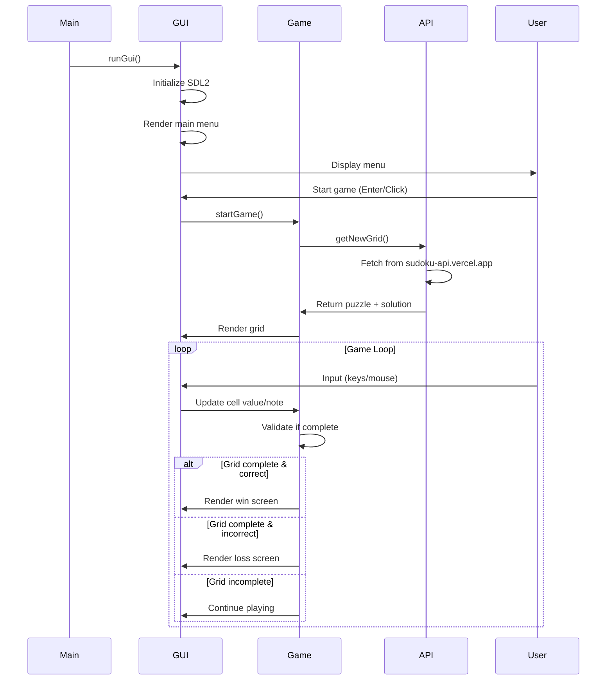

# cdoku

Sudoku game with GUI and automatic puzzle generation from API.

## Features

- **Auto-generated puzzles** - Fetches new Sudoku grids from online API
- **Interactive GUI** - SDL2-based graphical interface
- **Notes mode** - Add pencil marks to help solve puzzles (press `N` or click note icon)
- **Keyboard & mouse controls** - Navigate with arrow keys or click cells
- **Win/loss validation** - Automatic checking when grid is complete

## Execution Flow



## Project Architecture

```
src/
├── cdoku.c               # Main entry point
├── Makefile              # Build configuration
│
├── lib/                  # Third-party libraries
│   └── cJSON/            # JSON parsing library
│
├── game/                 # Game logic layer
│   ├── game.c/h          # Core game validation & orchestration
│   ├── api/              # External API integration
│   │   └── sudoku_api.c/h    # HTTP requests to Sudoku API
│   ├── parser/           # Data parsing
│   │   └── json_parser.c/h   # JSON to Grid conversion
│   └── rules/            # Sudoku domain logic
│       ├── cell.c/h      # Cell manipulation (values, notes)
│       └── grid.c/h      # Grid operations & validation
│
└── gui/                  # Presentation layer (SDL2)
    ├── gui.c/h           # Main GUI initialization & loops
    ├── input/            # Input handling
    │   └── input_handler.c/h # Event processing & key mapping
    ├── rendering/        # High-level rendering
    │   └── rendering.c/h     # Screens, grid, icons
    ├── cellRendering/    # Cell-level rendering
    │   └── cellRendering.c/h # Individual cell display
    ├── sectionRendering/ # Section-level rendering
    │   └── sectionRendering.c/h # 3x3 section borders
    ├── common/           # Shared GUI utilities & error handling
    ├── constants/        # UI constants (colors, sizes, positions)
    ├── fonts/            # Font assets
    └── images/           # Image assets
```

## Requirements

> Adapt commands to your system, example works for Ubuntu

- make

```bash
sudo apt install make -y
```

- SDL2

```bash
sudo apt install libsdl2-dev libsdl2-2.0-0 libsdl2-image-dev libsdl2-ttf-dev -y
```

- OpenSSL

```bash
sudo apt install libcurl4-openssl-dev -y
```

## Start

1. Compile

```bash
make -C src
```

2. Execute

```bash
./src/cdoku.out
```

3. Clean

```bash
make clean -C src
```

## Controls

- **1-9**: Insert number (or note if in note mode)
- **Arrow keys**: Navigate cells
- **N**: Toggle note mode
- **Backspace/Delete**: Clear cell
- **Mouse**: Click to select cells or toggle note mode
- **Enter**: Start game from main menu
